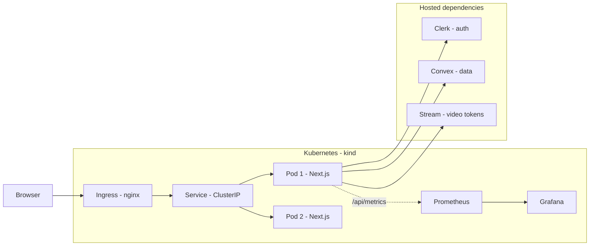

# Assessly

A comprehensive assessment platform built with Next.js, designed to streamline the creation, management, and evaluation of assessments.

## Features

- 📝 Create and manage assessments
- 👥 User management and authentication
- 📊 Real-time analytics and reporting
- 🎯 Customizable question types
- 🔒 Secure assessment environment

## Tech Stack

- **Frontend**: Next.js 14, React, TypeScript
- **Styling**: Tailwind CSS
- **Database**: Convex
- **Authentication**: Clerk

## Getting Started

### Prerequisites

- Node.js 18.x or higher
- npm or yarn package manager

### Installation

1. Clone the repository:
   ```bash
   git clone https://github.com/Harsh-svg988/Assessly.git
   cd Assessly
   ```

2. Install dependencies:
   ```bash
   npm install
   ```

3. Set up environment variables:
   ```bash
     NEXT_PUBLIC_CLERK_PUBLISHABLE_KEY=
    CLERK_SECRET_KEY=
    CONVEX_DEPLOYMENT=
    NEXT_PUBLIC_CONVEX_URL=
    NEXT_PUBLIC_STREAM_API_KEY=
    STREAM_SECRET_KEY=
   ```


4. Run the development server:
   ```bash
   npm run dev
   ```

5. Open [http://localhost:3000](http://localhost:3000) in your browser.

## Available Scripts

- `npm run dev` - Start the development server
- `npm run build` - Build the application for production
- `npm run start` - Start the production server
- `npm run lint` - Lint the codebase

---

## DevOps: Architecture, Deployment, CI/CD, Observability

This section documents the DevOps work added on top of the original application
(preserved at git tag `baseline`, commit `994e4ef`). All of it lives on top of
the same app — no feature changes beyond two real bugs the new lint checks
caught (see `git log` for details).

### Architecture

Assessly is a single Next.js 14 app (App Router) with three hosted/managed
dependencies it talks to over HTTPS:

- **Convex** — database + backend functions, mostly called client-side over
  a WebSocket from the browser.
- **Clerk** — authentication. `clerkMiddleware()` guards almost every route
  (see `src/middleware.ts`), including the API routes, so Clerk is on the
  request path for everything, not just login screens.
- **Stream** — video calling. Token generation happens server-side
  (`src/actions/stream.actions.ts`); the actual video connection is
  browser-to-Stream, not proxied through our server.

**What we containerize and run on Kubernetes is the Next.js app only.**
Convex/Clerk/Stream are external managed services — we don't run or own them,
which is also our main failure boundary: if any of them is down or slow, the
app degrades for the features that need it (e.g. no auth, no new Convex
reads/writes, no video token) but the container itself stays up and
`/api/health` still returns `200` (liveness is about "is this process alive
and able to respond", not "are all dependencies up" — that's what `/api/ready`
is for, see Observability below).

Request path for a real user action (e.g. opening the dashboard):
browser → Ingress (nginx) → Kubernetes Service → one of the app Pods →
Next.js Server Component → Convex (data) / Clerk (session) over HTTPS →
response rendered and returned.



### Running locally (without Docker/Kubernetes)

Prerequisites: Node.js 18+, npm, and your own Convex/Clerk/Stream dev
credentials (see "Set up environment variables" above).

```bash
npm install
npm run dev
# http://localhost:3000
```

### Running in Docker

```bash
docker build \
  --build-arg NEXT_PUBLIC_CLERK_PUBLISHABLE_KEY=<value> \
  --build-arg NEXT_PUBLIC_CONVEX_URL=<value> \
  --build-arg NEXT_PUBLIC_STREAM_API_KEY=<value> \
  -t assessly:dev .

docker run -p 3000:3000 \
  -e NEXT_PUBLIC_CLERK_PUBLISHABLE_KEY=<value> \
  -e CLERK_SECRET_KEY=<value> \
  -e CONVEX_DEPLOYMENT=<value> \
  -e NEXT_PUBLIC_CONVEX_URL=<value> \
  -e NEXT_PUBLIC_STREAM_API_KEY=<value> \
  -e STREAM_SECRET_KEY=<value> \
  assessly:dev
```

`NEXT_PUBLIC_*` vars must be passed as **build args** (Next.js inlines them
into the client bundle at build time); the three server-only secrets are
**runtime** env vars and are never baked into the image.

### Running on Kubernetes (local `kind` cluster)

Prerequisites: Docker, `kind`, `kubectl`, `helm`.

```bash
# 1. Create the cluster (with port mappings for ingress-nginx)
kind create cluster --config k8s/kind-config.yaml

# 2. Install ingress-nginx (kind-specific manifest)
kubectl apply -f https://raw.githubusercontent.com/kubernetes/ingress-nginx/main/deploy/static/provider/kind/deploy.yaml
kubectl wait --namespace ingress-nginx --for=condition=ready pod \
  --selector=app.kubernetes.io/component=controller --timeout=180s

# 3. Build the image and load it into kind (skips needing a registry for local use)
docker build --build-arg NEXT_PUBLIC_CLERK_PUBLISHABLE_KEY=<value> \
  --build-arg NEXT_PUBLIC_CONVEX_URL=<value> \
  --build-arg NEXT_PUBLIC_STREAM_API_KEY=<value> \
  -t assessly:dev .
kind load docker-image assessly:dev --name assessly

# 4. Provide secrets: copy helm/assessly/values.secret.yaml.example to
#    helm/assessly/values.secret.yaml (gitignored) and fill in real values.

# 5. Deploy
kubectl create namespace assessly
helm upgrade --install assessly ./helm/assessly -n assessly \
  -f helm/assessly/values.secret.yaml \
  --set image.repository=assessly --set image.tag=dev --set image.pullPolicy=IfNotPresent

# 6. Access
echo "127.0.0.1 assessly.local" | sudo tee -a /etc/hosts
curl http://assessly.local/api/health
curl http://assessly.local/api/ready
open http://assessly.local
```

The Helm chart (`helm/assessly`) includes: a 2-replica Deployment with
`RollingUpdate(maxUnavailable: 0)`, liveness/readiness probes, resource
requests/limits, a non-root/read-only-root-filesystem `securityContext`, a
ClusterIP Service, an Ingress, a ConfigMap for public config, a Secret for
server-only credentials (kept out of git — see Security below), an optional
HPA (`autoscaling.enabled=true`), and a NetworkPolicy.

### CI/CD (`.github/workflows/ci-cd.yml`)

```
lint-and-build  →  docker-build-scan-push  →  integration-deploy  →  promote
(lint, build,      (build image, Trivy        (spin up a throwaway    (manual-approval
 gitleaks scan)     vuln scan, push to         kind cluster, helm      gated; tags the
                     GHCR tagged by             install, wait for      validated image
                     commit SHA)                 rollout, smoke-test    as :stable/:latest)
                                                 through the real
                                                 Service with curl)
```

Every push gets built, scanned, and deployed to a real (if ephemeral)
Kubernetes cluster inside the CI runner, then smoke-tested with actual HTTP
requests through the Service — not just "did the build succeed". Only a push
to `main` can reach `promote`, and that job requires manual approval via the
`Production` GitHub Environment (Settings → Environments → Production →
required reviewers) before the validated image is retagged `stable`/`latest`.

**Release control / rollback:** the image pushed to GHCR is tagged with the
git SHA it was built from (`sha-<12 chars>`), so the running version is always
traceable to a commit. A bad release is rolled back with:

```bash
helm rollback assessly <previous-revision> -n assessly
# or: helm history assessly -n assessly   (to see available revisions)
```

A real fault-injection + rollback run (not hypothetical) is documented in
[`docs/incident-demo.md`](docs/incident-demo.md).

### Observability

- **`/api/health`** — liveness: is the process up and able to respond.
- **`/api/ready`** — readiness: is the required configuration for
  Convex/Clerk/Stream present (503 if not). Both are wired into the
  Deployment's probes.
- **`/api/metrics`** — Prometheus-format metrics (`prom-client`): default
  Node process metrics (CPU, memory, event-loop lag, GC), an
  `assessly_http_requests_total` counter and
  `assessly_http_request_duration_seconds` histogram for the routes we
  explicitly instrument, and `assessly_external_dependency_duration_seconds`
  for calls out to Clerk (an example of measuring dependency latency, not
  just our own).
- **Structured error logs** via `src/instrumentation.ts`'s `onRequestError`
  hook — every uncaught server-side error is logged as one JSON line
  (path, method, message, timestamp), visible with `kubectl logs`.
- **Ingress access logs** — ingress-nginx logs method/path/status/latency for
  every request that reaches the app, with zero extra code — visible via
  `kubectl logs -n ingress-nginx deploy/ingress-nginx-controller`.
- **Prometheus + Grafana** run in-cluster (`monitoring` namespace,
  `helm/monitoring/`) scraping `/api/metrics` off both pods (pod
  annotations `prometheus.io/scrape`), with a provisioned dashboard
  (`helm/monitoring/assessly-dashboard.json`) showing request rate, p95
  latency by route, dependency latency, and process memory/CPU.

```bash
helm repo add prometheus-community https://prometheus-community.github.io/helm-charts
helm repo add grafana https://grafana.github.io/helm-charts
kubectl create namespace monitoring
helm upgrade --install prometheus prometheus-community/prometheus -n monitoring \
  --set server.persistentVolume.enabled=false --set alertmanager.enabled=false \
  --set prometheus-pushgateway.enabled=false --set prometheus-node-exporter.enabled=false \
  --set kube-state-metrics.enabled=false
kubectl -n monitoring create configmap assessly-dashboard \
  --from-file=helm/monitoring/assessly-dashboard.json
helm upgrade --install grafana grafana/grafana -n monitoring -f helm/monitoring/grafana-values.yaml

kubectl -n monitoring port-forward svc/grafana 3333:80
# http://localhost:3333, user: admin, password:
#   kubectl get secret -n monitoring grafana -o jsonpath='{.data.admin-password}' | base64 -d
```

### Security

- **Secrets**: server-only credentials never enter the Docker image or git.
  Locally they live in a gitignored `helm/assessly/values.secret.yaml`
  (committed `.example` shows the shape); in CI they're GitHub Actions
  repository secrets, injected via `--set` at deploy time, never written to
  disk or logged.
- **Image scanning**: Trivy scans every built image in CI for CRITICAL/HIGH
  vulnerabilities and fails the pipeline on anything new/unreviewed. The
  runtime image also strips the npm CLI and its bundled deps (`tar`,
  `pacote`, `sigstore`, `cross-spawn`, ...) since the standalone server only
  needs the `node` binary, and runs `apk upgrade` to pick up patched OS
  packages — together these cleared 26 of the 38 findings Trivy originally
  reported. The remaining 12 (all Next.js/PostCSS CVEs needing the same
  Next 16 bump discussed above) are listed in `.trivyignore`, each with a
  reason — anything not explicitly listed there still fails the build.
- **Secret scanning**: gitleaks runs in CI on every push; a full-history scan
  of this repo (`gitleaks detect --log-opts="--all"`) found no leaked
  secrets.
- **Runtime hardening**: containers run as a non-root user (uid 1001),
  `readOnlyRootFilesystem: true`, `allowPrivilegeEscalation: false`, all
  Linux capabilities dropped, no auto-mounted ServiceAccount token.
- **Network**: a NetworkPolicy restricts the app Pods to inbound traffic on
  port 3000 and outbound to DNS + HTTPS only (see Known Limitations —
  enforcement depends on the CNI).
- **Dependencies**: `npm audit` findings went from 31 to 14 via non-breaking
  `npm audit fix`; the rest require major version bumps (Next 14→16,
  Tailwind 3→4, `@stream-io/node-sdk` 0.x→0.8) that were deliberately not
  done blind under a same-day deadline — tracked as a known risk, not
  silently ignored.

### Known limitations

- **NetworkPolicy enforcement**: `kind`'s default CNI (`kindnet`) does not
  enforce `NetworkPolicy` — the policy is written and would be enforced on
  any cluster with a policy-aware CNI (Calico, Cilium; GKE/EKS/AKS all
  support this), but isn't actively tested on this local cluster.
- **No real "production" target**: `promote` retags an image as
  `stable`/`latest` in GHCR; there's no second long-lived cluster to actually
  promote *to*. In a real environment this job would also deploy to a
  separate cluster/namespace behind the same approval gate.
- **Single environment**: one Helm values file, not per-environment
  overlays — acceptable per the assignment scope ("multiple live
  environments are not required").
- **`grafana/grafana` Helm chart is marked deprecated** upstream; it still
  installs and works for this demo, but a long-lived setup would use the
  `kube-prometheus-stack` chart instead (heavier, needs the Prometheus
  Operator CRDs — skipped here for setup time).
- **Readiness check scope**: `/api/ready` checks that required env vars are
  present, not that Convex/Clerk/Stream are actually reachable right now —
  a deliberate choice to avoid the probe flapping on a transient third-party
  blip that doesn't affect already-connected users.
- **No distributed tracing**: metrics and structured logs were prioritized
  over request-level tracing (e.g. OpenTelemetry spans across our server and
  Convex/Clerk/Stream calls) given the time available. The
  `assessly_external_dependency_duration_seconds` metric covers dependency
  latency at a coarser granularity; real distributed tracing would be the
  next thing added (Next.js supports this out of the box via `@vercel/otel`
  in `instrumentation.ts`, exported to a Tempo/Jaeger backend).

Built with ❤️ by the Harsh
